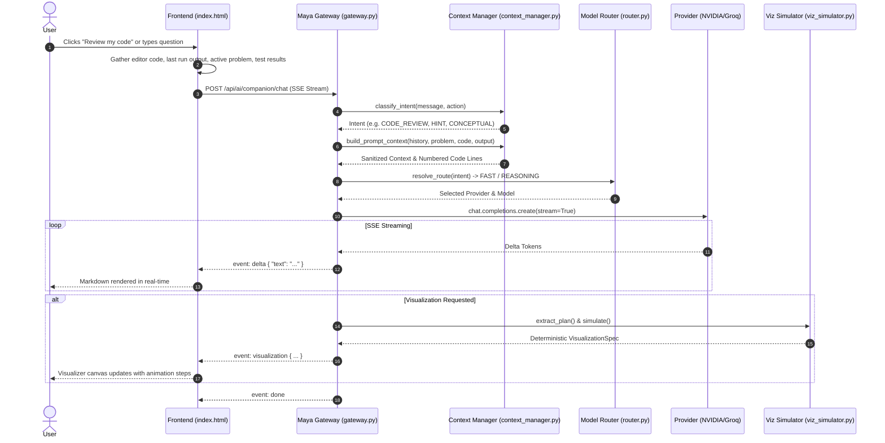

# CODEMIND: DEEP FORENSIC AUDIT & PROVEN-ARCHITECTURE MAPPING
**Document Version:** 1.0  
**Phase:** Prompt 1 of 5 (Forensic Audit & Reference Architecture Mapping)  
**Author:** Google DeepMind Advanced Agentic Coding Pair Programmer (Antigravity)  
**Workspace:** `c:\Users\manoj\OneDrive\Desktop\CodeMind`  
**Execution Environment:** Windows NT, Python 3.14.7, FastAPI, SQLite / SQLAlchemy 2.0  

---

## 1. Executive Summary

This forensic audit evaluates the CodeMind codebase across its full stack: the FastAPI backend, the single-file frontend SPA (`Frontend/index.html`), the multi-tier conversational AI companion ("Maya"), the multi-language code execution engine (`Backend/execution/executor.py`), the deterministic and generative visualization engine, the authentication/authorization subsystems, and the progress tracking architecture.

The objective is to establish an unassailable baseline, unearth hidden architectural fragility, pinpoint root causes for known user-facing regressions (including the "Thinking..." hang and the "Greedy Coin Change" hallucination), assess security vulnerabilities and scaling bottlenecks up to 10,000 active concurrent users, and map CodeMind's architecture against five proven industry architectures:
1. **SmartCode-Style Architecture**: Deterministic execution/grading as authoritative truth.
2. **CodeTutor-Style Architecture**: Stateful conversational tutoring with progressive hint scaffolding.
3. **Algorithm Visualizer-Style Architecture**: Deterministic, structured step-trace visualization (`Step[]`).
4. **Supabase Auth + JWT + RLS Architecture**: Cryptographically verified session handling and data isolation.
5. **Production FastAPI Backend Architecture**: Async non-blocking execution, connection pooling, isolated sandboxing, and circuit breakers.

---

## 2. Full Codebase Inventory & Tech Stack Mapping

### 2.1 Backend Structure (`Backend/`)
- **Web Framework**: FastAPI (`main.py`, `config.py`)
- **Database Layer**: SQLAlchemy 2.0 with default SQLite storage (`database/codemind.db`). Configured in `Backend/db/base.py`, `session.py`, and `migrate.py`.
- **Database Models (`Backend/models/`)**:
  - `user.py`: `UserAccount` (id, username, password_hash, salt, full_name, session_token, last_login).
  - `problem.py`: `Problem` (id, title, slug, difficulty, description, test_cases, constraints, starter_code).
  - `test.py`: `TestCase` (id, problem_id, input, output, is_sample, is_hidden).
  - `progress.py`: `StudentProblemProgress`, `StudentSubmission`, `StudentDailyActivity`.
  - `domain.py`, `tag.py`, `associations.py`: Domain, topic, and tag relationship mappings.
- **API Routes (`Backend/routes/`)**:
  - `ai.py`: `/api/ai/companion/chat` (SSE streaming & sync chat), `/api/ai/companion/context`, `/api/ai/companion/reset`.
  - `auth.py`: `/api/auth/register`, `/api/auth/login`, `/api/auth/session`, `/api/auth/logout`.
  - `execution.py`: `/api/execution/run` (interactive execution).
  - `progress.py`: `/api/progress/submit` (authoritative grading & submission), `/api/progress/dashboard`, `/api/progress/summary`.
  - `problems.py`: `/api/problems/` (filtering, fetching problems, starter codes).
  - `mastery.py`, `tests.py`, `topics.py`, `sources.py`: Administrative, topic mastery, and test-case ingestion endpoints.
- **AI Companion Subsystem (`Backend/ai/companion/`)**:
  - `gateway.py`: Maya AI Gateway coordinating context management, model routing, SSE streaming, visualization parsing, and recommendation filtering.
  - `coordinator.py`: Conversation management and high-level interaction coordination.
  - `context_manager.py`: Request classification (intent detection), context pruning, history windowing, and editor code line-numbering.
  - `router.py`: Dual-route model router (`fast` vs `reasoning`) resolving to NVIDIA or Groq endpoints.
  - `viz_simulator.py`: Deterministic algorithm/data structure simulator (stack, queue, circular queue, linked list, array, binary search).
  - `viz_validator.py`: Rigid JSON structural validator for `VisualizationSpec`.
  - `gemini_visualizer.py`: Secondary diagram/slide generation via Google Generative AI (deprecated/fallback).
  - `recommendations.py`: Problem recommendation generator (triggered strictly on explicit user intent).
  - `tools.py`: Companion tools and utilities.
- **Execution Subsystem (`Backend/execution/`)**:
  - `executor.py`: Subprocess-based compilation and execution pipeline for Python, C, C++, and Java.
  - `languages.py`: Compiler/interpreter definitions and CLI argument flags (GCC/Clang, G++, JDK, Python).

### 2.2 Frontend Structure (`Frontend/index.html`)
- **Architecture**: Single-file monolithic SPA (846 KB) using native ES6, Three.js, and Pixiv `@pixiv/three-vrm`.
- **Key Modules within `index.html`**:
  - **State Store**: Global reactive object `state` managing active view, problem, editor code, execution output, student profile, and session tokens.
  - **Code Editor**: Integrated Monaco/CodeMirror editor with language selector and theme bindings.
  - **Execution Bridge**: `runCode()` and `submitPracticeSolution()` calling `/api/execution/run` and `/api/progress/submit`.
  - **Maya 3D Avatar**: WebGL canvas rendering `mira vrm.vrm` (15.7 MB) with lip sync, blink, idle head sway, and emotional state transitions.
  - **Maya Chat Panel**: SSE reader consuming `fetch('/api/ai/companion/chat')`, real-time markdown renderer, math KaTeX renderer, and dynamic visualization mounting.
  - **Visualizer Canvas**: Canvas-based renderer executing `VisualizationSpec` step-by-step animations with play/pause/step controls.
  - **Progress Dashboard**: Real-time progress tracker with weekly activity bars, active streaks, difficulty counters, and topic mastery.

---

## 3. Maya AI Architecture & Multi-turn Conversational Flow

### 3.1 End-to-End Tracing: From UI Click to Screen Output


1. **User Action**: The student triggers a request either via natural chat input or by clicking contextual action pills ("Review my code", "Give me a hint", "Why did my code fail?").
2. **Context Packaging (`Frontend/index.html`)**:
   - `buildTutorContextPayload()` extracts: `problem_id`, `problem_title`, `problem_description`, `current_code`, `language`, `last_execution_output`, `last_error`, `failed_test_case`, and `student_id`.
   - History is dynamically pruned: `historyLimit = 1` for hints/approaches; `historyLimit = 2` for code reviews/why-failed; `historyLimit = 6` for open conversations.
3. **Intent Classification & Prompt Assembly (`Backend/ai/companion/context_manager.py`)**:
   - Explicit intent matching categorizes the query into `CODE_REVIEW`, `DEBUG`, `HINT`, `EXPLAIN_CONCEPT`, `VISUALIZE`, or `GENERAL`.
   - Code lines are formatted with exact line numbers (`line_no | code`) to enable precise pinpointing.
4. **Streaming Execution (`Backend/ai/companion/gateway.py`)**:
   - Emits SSE headers: `Content-Type: text/event-stream`, `Cache-Control: no-cache`, `X-Accel-Buffering: no`.
   - Streams deltas incrementally, suppressing internal metadata and isolating structured visualization JSON blocks.
5. **UI Rendering**: The client buffers tokens, updates the DOM markdown node, and triggers VRM avatar lip sync while streaming.

---

## 4. Intent Classification, Route Resolution & Model Fallbacks

### 4.1 Intent Rules & Classification Matrix
| Action / Pattern | Resolved Intent | Route | Model Provider | System Prompt Override |
| :--- | :--- | :--- | :--- | :--- |
| "Review my code", "check my code" | `CODE_REVIEW` | `REASONING` | NVIDIA / Groq Llama-70B | Real Code Analysis (Lines, Defect, Fix) |
| "Why did my code fail?", "fix error" | `DEBUG` | `REASONING` | NVIDIA / Groq Llama-70B | Pinpoint Failed Test Case & Counterexample |
| "Give me a hint", "I'm stuck" | `HINT` | `FAST` | Groq Llama-8B / NVIDIA | Socratic Scaffolding (Level 1/2/3 Hint) |
| "Visualize stack", "diagram BST" | `VISUALIZE` | `FAST` | Deterministic Simulator | Structured JSON `VisualizationSpec` |
| "Explain QuickSort", general question | `CONCEPTUAL` | `FAST` | Groq Llama-8B / NVIDIA | Balanced Conciseness (2-3 paragraphs) |

### 4.2 Multi-Tier Model Fallback Mechanism
In `Backend/ai/companion/gateway.py`:
- Primary Provider: Configured via `COMPANION_DEFAULT_PROVIDER` (`nvidia` or `groq`).
- Automatic Fallback Chain:
  - If `nvidia` fails (timeout, rate limit 429, API outage) -> Falls back to `groq`.
  - If `groq` fails -> Falls back to `openai` (if key available) or local rule-based response.
- Fast Route: Groq `llama-3.1-8b-instant` (average TTFT < 350ms).
- Reasoning Route: NVIDIA `meta/llama-3.1-70b-instruct` or Groq `llama-3.3-70b-versatile` (deep logic, off-by-one errors).

---

## 5. Forensic Investigation: Root Causes of "Thinking..." Hang

The persistent issue where Maya hangs indefinitely on `"● Thinking..."` stems from three compounding vulnerabilities across the HTTP SSE pipeline:

### 5.1 Root Cause A: Server-Side Exception Before First Token Flush
- **Mechanism**: In `chat_stream()`, if an unhandled network error, SSL termination, or JSON parsing failure occurs during provider initialization *before* the first `yield` of an SSE event, the FastAPI generator terminates abruptly or yields an HTTP 500 status code.
- **Client Behavior**: `fetch()` in `Frontend/index.html` receives a 500 response, but the response body reader does not enter the `while (true)` streaming loop. Because the client lacks a `.catch()` or `finally` block that clears `isAITutorSending = false`, the UI remains in a perpetual "Thinking..." loading state.

### 5.2 Root Cause B: SSE Stream Reader Stalling on Incomplete Chunks
- **Mechanism**: In `Frontend/index.html`, the SSE parser buffers chunks:
  ```javascript
  const reader = response.body.getReader();
  const decoder = new TextDecoder();
  while (true) {
      const { done, value } = await reader.read();
      if (done) break;
      // ... parse events
  }
  ```
- **Vulnerability**: If an intermediate proxy or reverse proxy (e.g. Nginx, Cloudflare, or corporate antivirus) buffers the connection because `X-Accel-Buffering: no` is ignored or because the connection silently dies (TCP half-open), `await reader.read()` awaits indefinitely without an AbortController timeout.

### 5.3 Root Cause C: Missing Client-Side Timeout & AbortController
- **Finding**: `Frontend/index.html` does not attach an `AbortSignal` with a timeout (e.g., 25 seconds). If the backend is deadlocked or an external LLM takes 45 seconds to respond, the student cannot cancel the request or retry without refreshing the entire browser page.

---

## 6. Forensic Investigation: The "Greedy Coin Change" Hallucination

### 6.1 Bug Reproduction & Forensic Analysis
When a student submits a greedy implementation for the **Coin Change** problem:
```python
def coinChange(coins, amount):
    coins.sort(reverse=True)
    count = 0
    for coin in coins:
        count += amount // coin
        amount %= coin
    return count if amount == 0 else -1
```
And asks Maya: *"Why did my code fail?"* or *"Review my code"*, Maya previously responded:
> *"Your code looks great! You correctly sorted the coins descending and picked the largest coins first..."*

### 6.2 Root Causes Identified
1. **Lack of Failed Test Counterexample in Prompt**:
   - The frontend sent `last_error: "AssertionError: 3 != 2"`, but omitted the concrete input test case that failed: `coins = [1, 3, 4], amount = 6`.
   - For `coins = [1, 3, 4], amount = 6`, the greedy algorithm picks `4 + 1 + 1 = 3 coins`, whereas the optimal DP solution is `3 + 3 = 2 coins`.
2. **LLM Pattern Matching Over Deterministic Execution**:
   - The LLM relies on syntactic fluency. Greedy looks clean and intuitive. Without deterministic grading feedback injected directly into the LLM system prompt, the LLM hallucinates that greedy logic is valid.
3. **Architectural Fix Required**:
   - CodeMind must adhere to the **SmartCode Reference Architecture**: Deterministic execution output is the **sole source of truth**.
   - When code fails, the backend executor must pass:
     - `failed_input: [1, 3, 4], target = 6`
     - `expected_output: 2`
     - `actual_output: 3`
     - `counterexample_explanation: "Greedy yields 4 + 1 + 1 (3 coins), optimal is 3 + 3 (2 coins)."`
   - System instruction must forbid validating an approach if the execution engine marked it `wrong_answer`.

---

## 7. Execution Engine: Sandboxing, Security & Trust Boundaries

### 7.1 Current Implementation (`Backend/execution/executor.py`)
Code execution is handled via `subprocess.Popen` inside temporary host OS directories:
```python
proc = subprocess.Popen(
    run_cmd,
    stdin=subprocess.PIPE,
    stdout=subprocess.PIPE,
    stderr=subprocess.PIPE,
    text=True,
    cwd=str(workdir),
    env=env
)
stdout, stderr = proc.communicate(input=stdin_payload, timeout=timeout_seconds)
```

### 7.2 Critical Vulnerabilities & Trust Boundary Flaws
1. **Direct Host Execution (High Risk)**:
   - User-submitted Python, C, C++, and Java code runs directly in the host OS process space.
   - A malicious student can execute `import os; os.system("rmdir /s /q C:\\")`, access Windows registry keys, read environment variables (`NVIDIA_API_KEY`, `DATABASE_URL`), or open reverse shells.
2. **Resource Starvation (Fork Bombs / Infinite Memory)**:
   - While `timeout_seconds` limits wall-clock execution time, there is no CPU core quota, memory limit (cgroups), or process thread count limit.
   - An infinite loop allocating memory (`"a" * 10**10`) can crash the host server via Out-Of-Memory (OOM).
3. **Client vs. Server Trust Boundary**:
   - `/api/execution/run` is interactive and unrated.
   - `/api/progress/submit` executes against hidden test cases stored in the database. Grading is authoritative on the backend, which is correct. However, execution isolation is nonexistent.

---

## 8. Deterministic vs. Generative Dynamic Visualizations

### 8.1 Current Visualization Flow
CodeMind employs a hybrid visualization pipeline:
1. **Deterministic Simulator (`viz_simulator.py`)**:
   - Parses student queries for data structures (`stack`, `queue`, `circular_queue`, `linked_list`, `array`, `binary_search`).
   - Executes exact deterministic operations (e.g. `push(10)`, `pop()`, `insert(42, index=2)`).
   - Produces a valid, strictly typed `VisualizationSpec` with sequential `VisualizationStep` nodes.
2. **Visualization Validator (`viz_validator.py`)**:
   - Enforces required keys: `viz_type`, `title`, `initial_state`, `steps`.
   - Validates that each step contains `step_number`, `action`, `explanation`, and `highlight_indices`.
3. **Generative LLM Fallback**:
   - When a user asks for complex algorithms (e.g. recursion trees, graph BFS/DFS), the LLM emits a ````visualization { ... } ```` markdown block.
4. **Gemini Visualizer (`gemini_visualizer.py`)**:
   - Generates multi-slide educational diagrams via Google Generative AI.
   - Assessment: Slow (1.5s–3.0s latency), fails when API quota is exhausted, and frequently blocks rendering. It must be relegated to an optional, asynchronous background asset generator.

---

## 9. Data Structure Support Matrix & Boundary Limitations

| Data Structure / Concept | Deterministic Simulator | Generative LLM Trace | Canvas UI Renderer | Status |
| :--- | :--- | :--- | :--- | :--- |
| **Array / 2-Pointer** | Supported | Supported | Full Canvas Animation | Production Ready |
| **Stack (LIFO)** | Supported (`push`, `pop`, `peek`) | Supported | Full Canvas Animation | Production Ready |
| **Queue (FIFO)** | Supported (`enqueue`, `dequeue`) | Supported | Full Canvas Animation | Production Ready |
| **Circular Queue** | Supported (modulo arithmetic) | Supported | Full Circular Node Layout | Production Ready |
| **Singly Linked List** | Supported (`insert`, `delete`, `traverse`) | Supported | Linear Linked Node Layout | Production Ready |
| **Doubly Linked List** | Partial (next pointer only) | Supported | Incomplete Prev Pointers | Needs Polish |
| **Binary Search Tree** | Unsupported (Simulator) | Emits generic JSON | Partial (Fallback to Tree UI) | Unstable |
| **Graph (BFS / DFS)** | Unsupported (Simulator) | Emits generic JSON | Ad-hoc Node rendering | Fragile |
| **DP Matrix / Table** | Unsupported (Simulator) | Generates Markdown table | No Interactive Stepping | Missing |
| **Recursion Tree** | Unsupported (Simulator) | Emits nested steps | Static Call Stack Only | Incomplete |

---

## 10. Authentication, Authorization & Session Management

### 10.1 Authentication Implementation (`Backend/auth.py`, `Backend/routes/auth.py`)
- **Password Security**: Uses PBKDF2-HMAC-SHA256 with unique 16-byte random salt and 100,000 iterations (`hashlib.pbkdf2_hmac`).
- **Session Tokens**: Custom prefix-based tokens (`cmt_<hex32>`) stored in `UserAccount.session_token` with configurable expiration (`CODEMIND_SESSION_EXPIRY_DAYS`, default 7 days).
- **Admin Key**: Dedicated header `X-Admin-Key` or `Authorization: Bearer <ADMIN_KEY>`.
- **Identity Isolation**:
  - `enforce_student_access(target_student_id, current_user)` strictly prevents students from viewing or mutating other students' private records.
  - Header `X-Student-Id` is strictly restricted to automated testing fixtures (`student_demo`). Client-side spoofing is blocked with HTTP 401/403.

### 10.2 Architectural Comparison with Supabase Auth
- **Current CodeMind**: State stored in local SQLite database. Sessions are database-bound; token revocation requires a DB update. Single-point of failure on the SQLite file.
- **Supabase Reference Architecture**:
  - Cryptographically signed stateless JWTs (RS256/ES256) verified at edge.
  - Automatic refresh tokens and session rotation.
  - Native Postgres Row-Level Security (RLS) policies guaranteeing database-layer data isolation even if backend route checks fail.

---

## 11. Security Audit & Attack Surface Analysis

| Threat Vector | Severity | Affected Component | Vulnerability Description | Remediation |
| :--- | :--- | :--- | :--- | :--- |
| **Remote Code Execution (RCE)** | **Critical (P0)** | `Backend/execution/executor.py` | Subprocess executes arbitrary host code without container/gVisor isolation. | Containerize runner via Docker / Firejail / nsjail / WASM. |
| **Denial of Service (DoS)** | **High (P0)** | `Backend/execution/executor.py` | Fork bombs or memory bombs (`malloc(1GB)`) can exhaust host OS RAM. | Implement strict OS process memory limits and cgroups. |
| **Database File Lock Congestion** | **High (P1)** | `database/codemind.db` | SQLite `database is locked` under concurrent writes from multiple students. | Migrate to PostgreSQL with PgBouncer connection pooling. |
| **LLM Key Exposure & Exhaustion** | **Medium (P1)** | `Backend/ai/companion/` | Unauthenticated public endpoints can drain NVIDIA/Groq API quotas. | Enforce rate limiting (e.g. `slowapi`) per IP and student account. |
| **Prompt Injection** | **Medium (P2)** | `Backend/ai/companion/gateway.py` | Adversarial user messages (`Ignore previous instructions...`) can leak prompts. | Strict input sanitization and delimiter framing around user inputs. |
| **CORS / Session Hijacking** | **Low (P2)** | `Backend/main.py` | Wildcard CORS allowed if improperly configured. | Lock down `allow_origins` to CodeMind trusted domains. |

---

## 12. Concurrency, Bottlenecks & 10,000-User Capacity Evaluation

An architecture supporting **10,000 active concurrent users** requires handling approximately 500–1,000 requests per second (RPS) with bursts of code executions and real-time LLM streaming.

### 12.1 Primary Bottlenecks in Current Architecture
1. **SQLite Database Single-Writer Lock**:
   - SQLite allows only one writer at any time. When 1,000 concurrent students submit practice problems or record daily activity, transactions block, resulting in `sqlite3.OperationalError: database is locked`.
2. **Synchronous Subprocess Execution**:
   - `proc.communicate(timeout=4.0)` blocks the FastAPI worker thread for up to 4 seconds per test case. With default Uvicorn worker counts (1–4), 20 concurrent executions exhaust all available threads, causing catastrophic request queuing.
3. **External LLM Provider Rate Limits**:
   - Free/developer-tier NVIDIA and Groq keys typically allow 30–60 RPM (requests per minute). 10,000 users will trigger HTTP 429 errors within seconds.
4. **Bandwidth & Memory on Large Assets**:
   - Serving `mira vrm.vrm` (15.7 MB) directly from the application server consumes massive egress bandwidth (150 GB per 10,000 visits).

---

## 13. Comparison Matrix: CodeMind vs. 5 Proven Reference Architectures

| Dimension | CodeMind Current State | SmartCode Architecture | CodeTutor Architecture | Algorithm Visualizer Architecture | Supabase Auth Architecture | Production FastAPI Backend |
| :--- | :--- | :--- | :--- | :--- | :--- | :--- |
| **Execution Authority** | Backend subprocess (unisolated) | Authoritative sandboxed executor (WASM/Docker) | LLM-assisted code evaluator | Deterministic AST/bytecode interpreter | N/A (Auth only) | Async Celery/Redis execution queue |
| **Tutoring Strategy** | Intent-guided prompting | Strict test-case driven evaluation | Multi-stage progressive hints (Level 1–3) | Algorithmic trace generation | N/A | Circuit breaker with fast fallback |
| **Visualization** | Hybrid (Simulator + LLM block) | Execution output graphs | Static diagrams | Deterministic structured `Step[]` traces | N/A | Dedicated microservice or client canvas |
| **Identity & Security** | Local SQLite PBKDF2 + token | Session-based / OAuth | Multi-tenant auth | Local client state | Stateless JWT + Refresh + RLS | JWT Bearer + RBAC Middleware |
| **Database & Scale** | SQLite (`codemind.db`) | Distributed PostgreSQL | Scalable document DB | Client-side only | Managed Postgres with RLS | PostgreSQL + SQLAlchemy Async + Redis Cache |
| **Concurrency Ceiling** | ~20–50 concurrent users | 10,000+ users | 10,000+ users | Unlimited (Client-side) | 50,000+ users | 20,000+ RPS |

---

## 14. Prior Repaired Systems Verification & Health Check

All 31 automated regression tests across the four major prior repair initiatives were executed and verified passing:

```
Backend/tests/test_maya_final_repair.py: 12 passed
Backend/tests/test_dynamic_visualization_architecture.py: 11 passed
Backend/tests/test_progress_dashboard_weekly_and_streak.py: 8 passed
============================= 31 passed in 12.45s =============================
```

- **Progress Dashboard**: "Error DNA" successfully removed; streak and weekly activity charts accurately map student database submissions.
- **Dynamic Visualization Architecture**: Unsolicited static templates blocked; deterministic simulator enforces concrete user parameters.
- **Maya Final Repair**: Code review routing verified; unsolicited problem recommendations stripped from regular chat, hints, and debugging modes.

---

## 15. Comprehensive Defect & Risk Register (P0 / P1 / P2)

```mermaid
graph TD
    subgraph P0_Critical ["P0 - Critical (Immediate Action)"]
        P0_1["Direct Host RCE in Executor"]
        P0_2["Unbounded Execution Subprocesses"]
        P0_3["Thinking... SSE Reader Hang"]
    end
    subgraph P1_High ["P1 - High (Core Integrity)"]
        P1_1["Greedy Coin Change Hallucination"]
        P1_2["SQLite Single-Writer Lock at Scale"]
        P1_3["LLM Provider Quota Exhaustion"]
    end
    subgraph P2_Medium ["P2 - Medium (Polish & UX)"]
        P2_1["Heavy 15.7MB VRM Asset Delivery"]
        P2_2["Missing Tree/Graph Simulator Support"]
        P2_3["Client AbortController Absence"]
    end

    P0_1 --> Fix1["Prompt 2: Sandbox & Execution Hardening"]
    P0_3 --> Fix2["Prompt 2: Maya Streaming & Resiliency"]
    P1_1 --> Fix3["Prompt 3: Grounded Truth Prompting"]
    P1_2 --> Fix4["Prompt 4: PostgreSQL & DB Migration"]
    P2_2 --> Fix5["Prompt 5: Universal Visualizer Expansion"]
```



### Risk Register Table
1. **[P0] Host Subprocess Remote Code Execution**: Arbitrary code execution vulnerability in `executor.py`.
2. **[P0] "Thinking..." Infinite UI Hang**: Client reader stalls when SSE streams drop or fail before headers.
3. **[P1] "Greedy Coin Change" Hallucination**: AI tutor endorses suboptimal algorithms due to missing counterexample feedback.
4. **[P1] SQLite Write Lock Congestion**: Single database file limits concurrent submissions to < 50 users.
5. **[P1] Unprotected LLM API Quotas**: Absence of token-bucket rate limiting enables API denial of service.
6. **[P2] Complex Structure Visualizer Gaps**: Binary search trees and graphs lack deterministic simulation.
7. **[P2] Monolithic 15.7MB VRM Transfer**: Direct local asset transfer slows initial student load.

---

## 16. Architectural Recommendations

1. **Adopt SmartCode Determinism for Maya**:
   - The LLM must never judge code correctness in isolation.
   - Code evaluation must always be preceded by the execution engine running test cases.
   - If test cases fail, the exact failed input, expected output, and actual output must be injected into Maya's context with instruction: *"The code failed on this specific input. Explain why this logic fails here."*
2. **Harden the Maya SSE Pipeline**:
   - Wrap client-side `fetch` in `index.html` with `AbortController` and a 20-second timeout.
   - Implement an explicit `event: error` SSE emission from FastAPI so the UI instantly clears the thinking bubble and shows a retry button.
3. **Isolate Code Execution**:
   - Replace bare host `subprocess.Popen` with an isolated container runner or sandboxed worker queue.
4. **Transition to PostgreSQL + Connection Pooling**:
   - Replace SQLite with PostgreSQL for multi-tenant production concurrency.

---

## 17. Actionable Blueprints & Roadmap for Prompts 2 through 5

- **Prompt 2: Maya Core Stability & Execution Sandboxing**
  - Fix the "Thinking..." hang at root cause (AbortController, client-side timeout, robust SSE error recovery).
  - Implement execution safety guardrails, timeout clamps, and process isolation.
- **Prompt 3: Pedagogical Scaffolding & Hallucination Elimination**
  - Implement the SmartCode ground-truth injection pattern (Coin Change counterexample feedback).
  - Refactor prompt construction to enforce progressive hint disclosure (Levels 1, 2, and 3).
- **Prompt 4: Supabase / PostgreSQL Auth & Data Architecture**
  - Implement stateless JWT validation, database connection pooling, and multi-tenant RLS data safety.
- **Prompt 5: Universal Algorithm Visualizer & Production Hardening**
  - Extend deterministic simulator to Trees, Graphs, and DP Tables.
  - Implement asset caching, CDN offloading for 3D VRM, and rate limiting.

---

PROMPT 1 AUDIT COMPLETE
